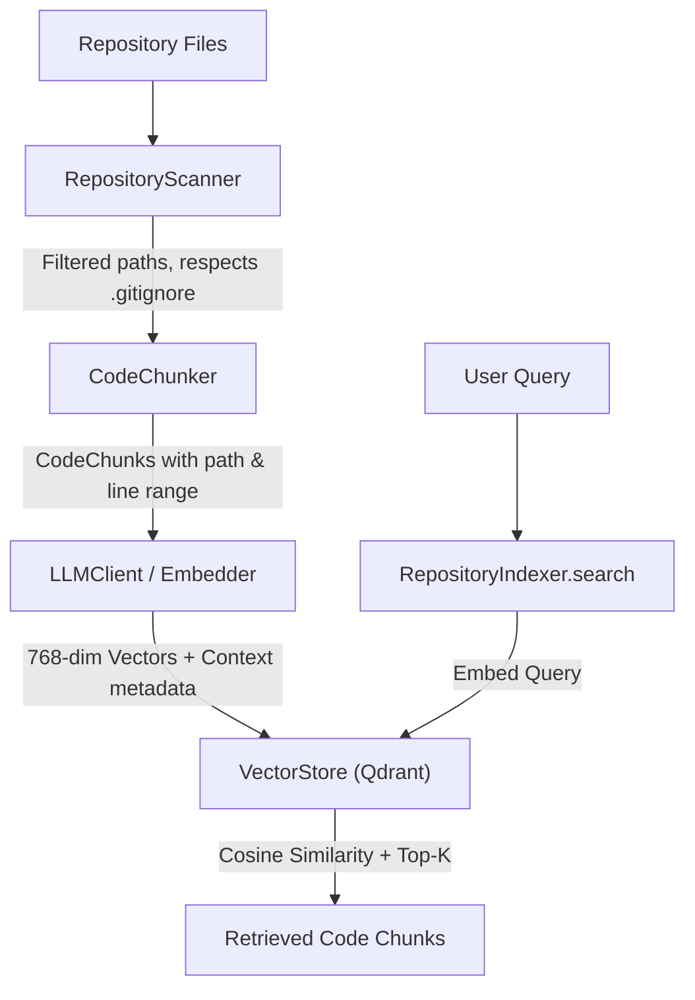

# CodePilot Architecture

## Overview

CodePilot is a full-stack AI coding assistant.
The React frontend communicates with a FastAPI
backend, which manages application logic and
interacts with LLMs and development tools.

## Components

### Frontend
- React + Vite
- Chat interface
- Repository and code views

### Backend
- FastAPI routes
- Pydantic schemas
- Application services
- Configuration management

### LLM Layer
- Provider integration
- Prompt management
- Structured outputs
- Tool calling

### Future Components
- Repository ingestion and retrieval
- AST and Tree-sitter analysis
- Agent execution loop
- MCP integration
- Git and test-runner tools

## Initial Request Flow

1. User interacts with React.
2. React sends an HTTP request to FastAPI.
3. FastAPI validates the request.
4. Application logic processes it.
5. FastAPI returns a JSON response.
6. React displays the result.

## Repository Indexing Pipeline (Week 1 Milestone)

CodePilot transforms a raw codebase into a semantically searchable vector index through a 5-stage ingestion pipeline.



### Ingestion Components

1. **RepositoryScanner (`app/services/repository_scanner.py`)**:
   - Traverses repository directories safely.
   - Excludes `.git/`, virtual environments (`.venv/`), build outputs (`node_modules/`, `dist/`), and secret files (`.env`, `*.key`).
   - Parses root `.gitignore` to dynamically match custom ignore patterns using `pathspec`.
   - Filters out binary files via null-byte inspection.

2. **CodeChunker (`app/services/code_chunker.py`)**:
   - Implements a sliding line-window algorithm (`chunk_size=40`, `overlap=8`).
   - Overlap guarantees structural continuity for functions and classes spanning chunk boundaries.
   - Attaches 1-indexed `start_line` and `end_line` for precise source attribution.

3. **Embedding Generation (`app/llm/client.py`)**:
   - Generates 768-dimensional float vectors using Google Gemini `text-embedding-004`.
   - Embeds context-enriched strings (`File: <path>\nLanguage: <lang>\n\n<code>`) to ensure vector space proximity for file names and architectural roles.

4. **Vector Database (`app/services/vector_store.py`)**:
   - Built on Qdrant (`qdrant-client`).
   - Stores vectors with cosine distance indexing.
   - Uses deterministic `UUID5` identifiers based on chunk coordinate signatures (`path:start_line-end_line`) for idempotent updates.
   - Supports native payload metadata filtering (e.g. `language == 'python'`).

5. **Unified Indexer (`app/services/indexer.py`)**:
   - Coordinates scanning, chunking, embedding, and upserting.
   - Provides a high-level `search(query, limit)` interface for downstream RAG consumption.


## Repository Indexing Pipeline (Week 1 Milestone)

CodePilot transforms a raw codebase into a semantically searchable vector index through a 5-stage ingestion pipeline.

```mermaid
flowchart TD
    A[Repository Files] --> B[RepositoryScanner]
    B -->|Filtered paths, respects .gitignore| C[CodeChunker]
    C -->|CodeChunks with path & line range| D[LLMClient / Embedder]
    D -->|768-dim Vectors + Context metadata| E[VectorStore Qdrant]
    
    F[User Query] --> G[RepositoryIndexer.search]
    G -->|Embed Query| E
    E -->|Cosine Similarity + Top-K| H[Retrieved Code Chunks]